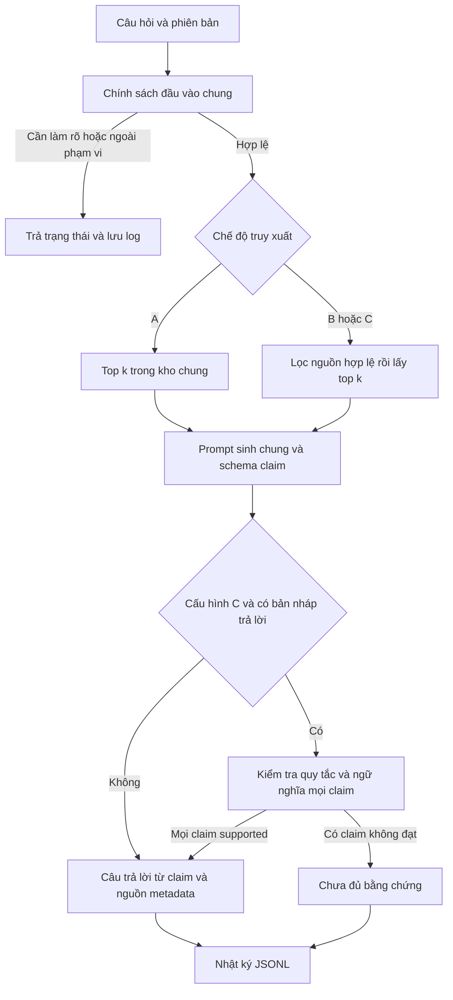

# Hướng dẫn đọc mã và giải thích đồ án

Ứng dụng bổ sung tài liệu vào lúc trả lời bằng RAG. Nó không cập nhật trọng số LLM. Embedding giúp tìm đoạn gần nghĩa; LLM sinh từng nhận định; verifier đối chiếu nhận định với nguồn. Cả bộ sinh và bộ kiểm chứng đều có thể sai.

## Buổi 1 Chính sách phiên bản

Đọc `src/version_policy.py`. Chạy `scripts.ask` với câu thiếu phiên bản, phiên bản mâu thuẫn và bản ngoài phạm vi. Ba trường hợp này chưa cần LLM. Giải thích vì sao việc hỏi lại áp dụng chung cho cả A/B/C, không được coi là cải thiện riêng của B.

Bài tập: trong test `test_filter_before_topk`, sáu đoạn sai phiên bản được xếp cao hơn đoạn đúng. Nếu lấy top 5 trước rồi mới xóa sai phiên bản, đoạn đúng sẽ mất. Tìm chính xác đoạn mã lọc trước xếp hạng trong `src/retrieve.py`.

## Buổi 2 Nguồn và đoạn văn

Đọc manifest sau khi chạy `src.collect`, chọn một source_id và đối chiếu HTML, URL cuối, SHA256. Xem `src/chunk.py`: chủ thể/hàm là đơn vị cha, các đoạn con có mapping về cha. Thử một ví dụ có mã thụt lề và một câu phủ định. Xác nhận trích xuất giữ nguyên ý nghĩa.

Giải thích khác nhau giữa source_version và history_targets. URL của ghi chú lịch sử vẫn thuộc phiên bản gốc. Người rà soát chỉ xác nhận sự kiện lịch sử cụ thể, không chuyển nhãn toàn bộ trang.

## Buổi 3 Embedding và tìm kiếm

Đọc `src/embedding.py` và `src/retrieve.py`. Vector là một dãy số; dot product của vector đã chuẩn hóa là điểm cosine. Thứ tự vector và chunk_id phải khớp. Điểm cao chỉ thể hiện độ liên quan theo mô hình, không bảo đảm đúng phiên bản hay đúng ngữ nghĩa.

Chạy tìm kiếm chưa kết nối LLM, xem nguồn đúng có trong top k không. Nếu không, kiểm tra dữ liệu, cách chia đoạn và diễn đạt câu hỏi trước. Không dùng model sinh để che lỗi tìm kiếm.

## Buổi 4 Claim và nguồn

Đọc `src/generate.py`. JSON chỉ giúp kiểm tra cấu trúc: status hợp lệ, claim không rỗng, applies_to phù hợp, evidence_ids tồn tại. Nó không tự chứng minh claim đúng.

Mỗi claim là một ý; câu trả lời cuối được ghép từ claim. Link hiển thị lấy từ metadata, không lấy URL do LLM nghĩ ra. Tìm test `test_extra_url_field_is_error` và giải thích lỗi đang ngăn ngừa.

## Buổi 5 Kiểm chứng

Đọc `src/verify.py`, `src/pipeline.py`. C nhận chính bản nháp và bằng chứng của B, không sinh lại hay truy xuất thêm. Lớp quy tắc xét điều kiện nguồn; lớp LLM xét nội dung/điều kiện/phiên bản. Thiếu verdict hoặc JSON hỏng là lỗi, không được mặc định supported.

Nếu một claim không đạt, bản đầu từ chối toàn bộ bản nháp. C có thể tăng độ đúng trên phần đã trả nhưng giảm bao phủ. Dùng cùng LLM để sinh và kiểm chứng không khiến chúng trở thành hai giám khảo độc lập.

## Buổi 6 Thực nghiệm và bảo vệ

Đọc `notes/CHAM_DIEM.md` và `scripts/evaluate.py`. Giải thích dev/test, group_id, đóng băng, tử số/mẫu số, và vì sao C phải tính cả chi phí B. Chạy demo_offline để học đường đi dữ liệu; khi trình bày cần nói rõ đó là kiểm thử giả lập, không phải bằng chứng hiệu quả RAG.

Tự trả lời các câu sau bằng mã và log của chính dự án:

1. Tại sao có link nhưng câu trả lời vẫn có thể sai?
2. Tại sao không tìm thấy chưa chứng minh tính năng không tồn tại?
3. A và B khác đúng yếu tố nào? Các yếu tố nào được giữ cố định?
4. B và C có cùng bản nháp ở phép so sánh không? Log nào chứng minh?
5. Vì sao C từ chối nhiều hơn chưa đủ kết luận tốt hơn?
6. Phần nào tự cài đặt và phần nào dùng thư viện/mô hình có sẵn?
7. Tập dữ liệu nhỏ cho phép kết luận trong phạm vi nào?
